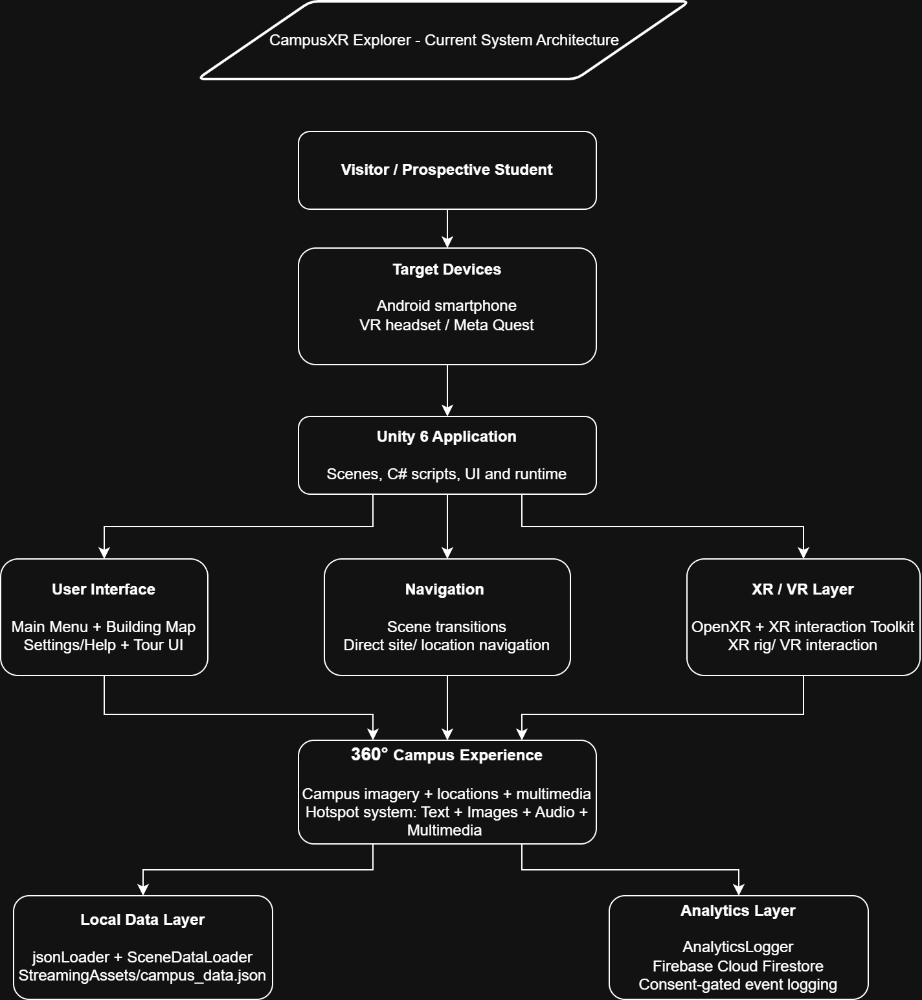

# CampusXR Explorer – System Architecture

## System Architecture Diagram

## Architecture Explanation

CampusXR Explorer uses a modular Unity-based architecture. The user accesses
the application through an Android device or VR headset. Unity provides the
main runtime and manages the user interface, navigation, campus scenes and
XR functionality.

The interface layer includes the Main Menu, Building Map, Settings/Help and
tour interface. The navigation layer manages scene transitions and direct
site/location navigation. The XR layer uses OpenXR, Unity XR Plugin Management
and the XR Interaction Toolkit.

The data layer separates campus information from application logic.
`JsonLoader` reads `campus_data.json` from StreamingAssets and converts the
data into `CampusData` objects. `SceneDataLoader` then matches the active
Unity scene with the appropriate `LocationData` entry.

The analytics layer uses `AnalyticsLogger` and Firebase Cloud Firestore for
consent-based analytics event logging.