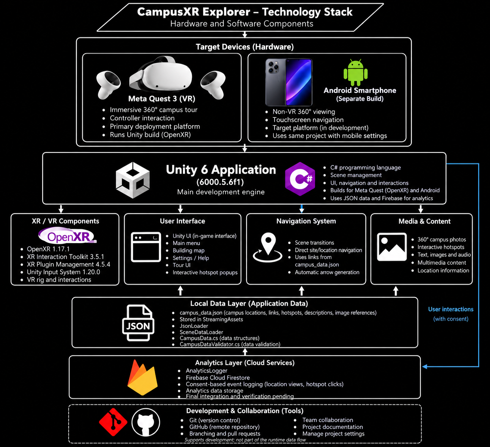

# CampusXR Explorer – Technology Stack

## 1. Technology Stack Overview

CampusXR Explorer is an immersive virtual campus tour application developed for Belgium Campus iTversity Kempton Park. The application allows prospective students and visitors to explore campus facilities through interactive 360-degree environments, navigation arrows and information hotspots.

The project uses Unity 6 and C# as its main development technologies, supported by XR frameworks, JSON-based data management, Firebase Cloud Firestore and GitHub.

The technology stack supports immersive VR functionality, structured campus information, user interaction and collaboration between development team members.

The current VR prototype has been successfully built and demonstrated on a Meta Quest headset. Android smartphone support is being developed as a separate build configuration.

## 2. Technology Stack Diagram

The technology stack diagram shows the hardware and software components used in CampusXR Explorer. These include the target devices, Unity development environment, XR technologies, user interface tools, local data components, cloud analytics and version control tools.

## 3. Technology Stack Table

| Category | Technology / Component | Purpose |
|---|---|---|
| Game Engine | Unity 6 (6000.5.6f1) | Main development engine for creating the application, scenes and interactive campus environments. |
| Programming Language | C# | Implements navigation, hotspots, data loading and application logic. |
| XR Framework | OpenXR 1.17.1 | Provides VR runtime support for compatible hardware. |
| XR Interaction | XR Interaction Toolkit 3.5.1 | Supports immersive interaction and VR controller functionality. |
| XR Management | Unity XR Plugin Management 4.5.4 | Manages XR providers and headset configurations. |
| Input Management | Unity Input System 1.20.0 | Handles input from supported controllers and devices. |
| VR Hardware | Meta Quest headset | Hardware used for the working VR prototype. |
| Mobile Platform | Android smartphone | Target device for a separate non-VR mobile build. |
| User Interface | Unity UI | Implements the main menu, campus map, settings and hotspot popups. |
| Interface Design | Figma | Used to plan and design interface layouts. |
| Local Data Storage | JSON / StreamingAssets | Stores campus locations, navigation links, hotspots, descriptions and image references. |
| Data Loading | JsonLoader / SceneDataLoader | Loads JSON data and identifies the relevant campus locations. |
| Data Structures | CampusData.cs | Defines campus location, navigation link and hotspot data structures. |
| Data Validation | CampusDataValidator.cs | Checks for duplicate identifiers, invalid navigation targets and other data problems. |
| Cloud Analytics | Firebase Cloud Firestore | Supports consent-based analytics event storage; final verification pending. |
| Analytics Component | AnalyticsLogger | Provides functionality for recording user interaction events subject to consent. |
| Immersive Media | 360-degree campus photographs | Provides the visual environments for the virtual campus tour. |
| Version Control | Git and GitHub | Supports version control, pull requests and team collaboration. |
| Development Environment | Unity Editor | Used to configure, test and build the application. |

## 4. Technology Stack Explanation

### 4.1 Unity 6 and C#

Unity 6 is the main development engine used for CampusXR Explorer. It provides the tools needed to create immersive 360-degree environments, manage scenes, develop user interfaces and integrate VR functionality.

C# is the primary programming language used to implement the application's behaviour. C# scripts manage navigation between campus locations, interactive hotspots, JSON data loading and analytics functionality.

Using Unity and C# allows the development team to separate different responsibilities into components, making the application easier to maintain, test and extend.

### 4.2 OpenXR and XR Technologies

OpenXR provides the foundation for virtual reality functionality and supports communication with compatible XR runtimes.

Unity XR Plugin Management manages the XR configuration, while the XR Interaction Toolkit supports interactions within immersive environments.

The Unity Input System handles user input from supported controllers and devices.

Together, these technologies support the application's immersive VR experience and its current Meta Quest prototype.

### 4.3 Meta Quest and Android Smartphone

The Meta Quest headset is the primary VR hardware platform used for the current CampusXR Explorer prototype.

The team has successfully built and demonstrated the application on a Meta Quest headset, allowing users to explore immersive 360-degree campus environments.

Android smartphones are also a target platform. However, smartphone deployment is being developed as a separate build configuration because mobile devices require touchscreen navigation and non-VR viewing controls.

The Android smartphone version should only be considered successfully deployed once installation and functional testing have been completed.

### 4.4 JSON and Local Data Management

CampusXR Explorer uses JSON to manage campus information separately from the main application logic.

The `campus_data.json` file is stored in Unity's `StreamingAssets` directory. It contains campus location identifiers, navigation links, hotspot information, descriptions and image references.

The `JsonLoader` component loads structured campus information and converts it into C# data objects.

The `SceneDataLoader` component identifies the relevant campus information using site identifiers, with scene-name lookup available as a fallback.

The data structures are defined in `CampusData.cs`, which represents campus locations, hotspots and navigation links.

The project also includes `CampusDataValidator.cs`, which checks for potential problems such as duplicate identifiers, invalid navigation targets and excessive hotspots.

This data-driven approach allows the development team to update campus content without modifying the main application logic for every change.

### 4.5 Firebase Cloud Firestore and Analytics

Firebase Cloud Firestore is included in the project to support cloud-based analytics.

The `AnalyticsLogger` component is designed to record interactions such as viewing campus locations and activating hotspots.

Analytics logging is intended to operate only after the user has provided consent.

The information can help the development team understand how visitors interact with the virtual campus tour and identify opportunities for improvement.

Final integration and verification of Firebase event logging are still being completed for Milestone 2.

### 4.6 Unity UI and Figma

Unity UI is used to implement the application's main menu, campus map, settings and interactive hotspot popups.

The campus map allows users to select different campus locations, while hotspot popups provide additional descriptions, images and navigation options.

Figma was used during the design process to plan interface layouts and visual elements before implementing them in Unity.

These tools support a consistent and understandable user interface.

### 4.7 360-Degree Campus Media

The application uses 360-degree photographs of Belgium Campus Kempton Park to create immersive virtual environments.

These photographs are combined with navigation arrows and interactive hotspots, allowing visitors to explore connected campus locations.

Hotspot images and descriptions provide information about classrooms, reception, the cafeteria, study areas and other campus facilities.

The architecture also accommodates audio and multimedia content, with integration and testing continuing as part of Milestone 2.

### 4.8 Git and GitHub

Git and GitHub are used for version control and team collaboration throughout the project.

Git allows developers to track changes, while GitHub provides a shared repository for managing project files.

Team members can develop features using branches, submit pull requests, review changes and integrate approved contributions into the main project.

GitHub also stores the project's technical documentation, including architecture diagrams, technology stack documentation, UML diagrams, deployment instructions and testing results.

## 5. Deployment Platforms

### 5.1 Meta Quest VR

The current CampusXR Explorer prototype has been successfully built and demonstrated on a Meta Quest headset.

The VR version uses Unity and XR technologies to provide immersive campus exploration, interactive navigation and 360-degree environments.

Further integration and testing are continuing as part of Milestone 2.

### 5.2 Android Smartphone

Android smartphone support is being developed as a separate build configuration.

The smartphone version requires touchscreen controls and non-VR viewing functionality.

Successful smartphone deployment should only be reported after installation and functional testing have been completed.

## 6. Technology Stack Summary

The CampusXR Explorer technology stack combines Unity 6, C#, OpenXR, Unity XR components, JSON data management, Firebase Cloud Firestore and GitHub.

Unity and C# provide the main application development foundation, while XR technologies support immersive virtual reality functionality.

JSON allows campus information and navigation data to be maintained separately from the application's main logic.

Firebase provides the foundation for consent-based analytics, while GitHub supports team collaboration and version control.

Together, these technologies support the current Meta Quest prototype and provide a maintainable foundation for future improvements to navigation, analytics and Android smartphone compatibility.