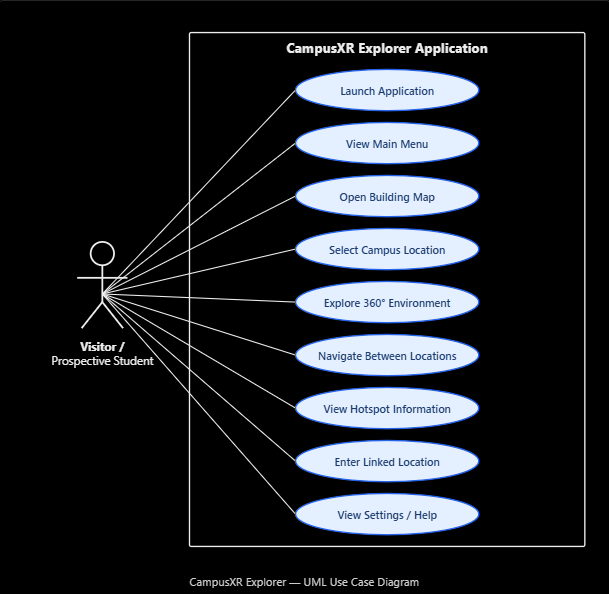
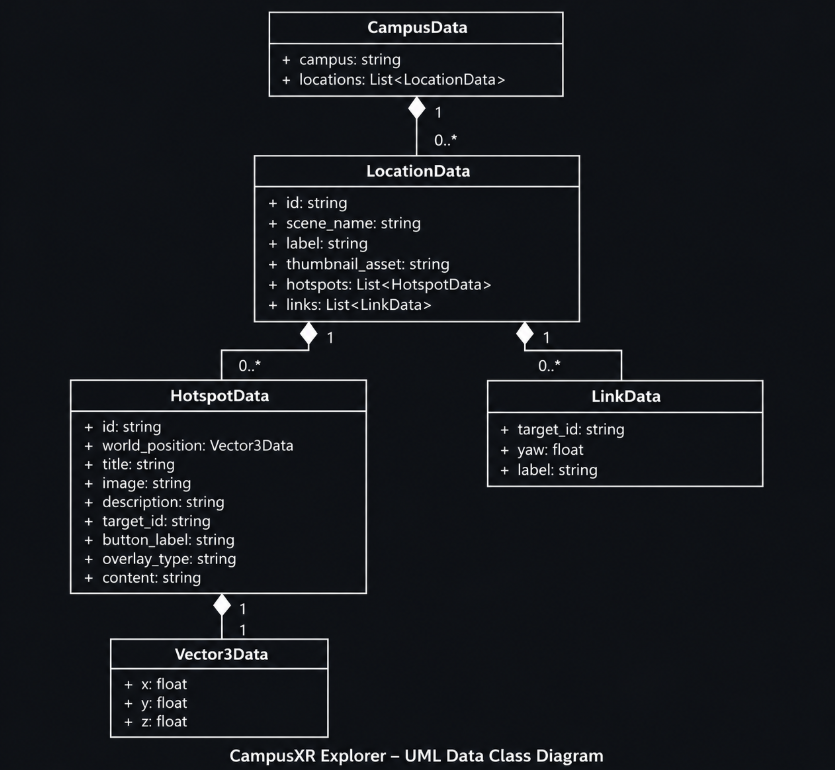
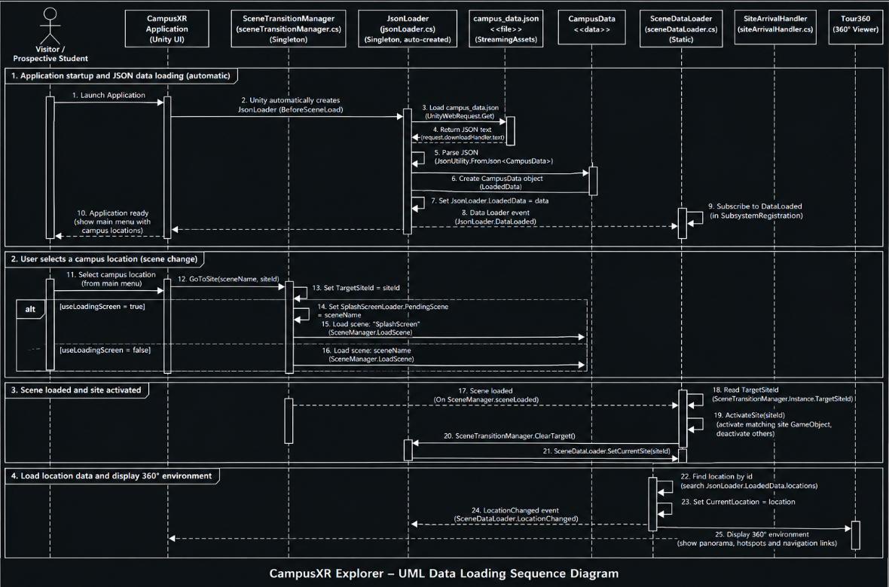

# CampusXR Explorer – UML Diagrams

## Overview

This document presents three UML diagrams for the CampusXR Explorer project: a Use Case Diagram, a Data Class Diagram, and a Data Loading Sequence Diagram.

These diagrams describe how visitors interact with the virtual campus tour, how campus information is structured, and how Unity loads and manages location data.

The diagrams support the system architecture documentation for PRJ381 Milestone 2.

---

## 1. UML Use Case Diagram

### Description

The Use Case Diagram shows the main functions available to a visitor or prospective student using CampusXR Explorer.

The visitor can launch the application, access the main menu, open the building map, select campus locations, and explore 360-degree environments.

Visitors can also navigate between connected locations and interact with information hotspots to learn more about campus facilities.

The diagram includes settings and help as part of the intended application interface.

### Main Actor

**Visitor / Prospective Student:** The person using CampusXR Explorer to explore the campus virtually.

### Main Use Cases

- Launch Application
- View Main Menu
- Open Building Map
- Select Campus Location
- Explore 360° Environment
- Navigate Between Locations
- View Hotspot Information
- Enter Linked Location
- View Settings / Help

---

## 2. UML Data Class Diagram

### Description

The Data Class Diagram represents the structure of the campus information stored in `campus_data.json`.

The classes are defined in `CampusData.cs` and are used to convert JSON data into C# objects that Unity can access.

### Main Classes

**CampusData**

Stores the campus name and a collection of campus locations.

- `campus`: Campus name
- `locations`: List of location objects

**LocationData**

Represents an individual location in the virtual campus tour.

- `id`: Unique location identifier
- `scene_name`: Unity scene associated with the location
- `label`: Location display name
- `thumbnail_asset`: Location thumbnail reference
- `hotspots`: List of information hotspots
- `links`: List of navigation connections

**HotspotData**

Stores information displayed when visitors interact with hotspots.

- `id`: Hotspot identifier
- `world_position`: Hotspot position in the 360° environment
- `title`: Popup heading
- `image`: Associated image reference
- `description`: Information about the location or facility
- `target_id`: Optional destination location
- `button_label`: Optional navigation button text
- `overlay_type`: Content type
- `content`: Associated content

**LinkData**

Represents navigation connections between campus locations.

- `target_id`: Destination location identifier
- `yaw`: Horizontal direction of the navigation arrow in degrees
- `label`: Optional navigation label

**Vector3Data**

Stores the three-dimensional position of a hotspot.

- `x`: Horizontal position
- `y`: Vertical position
- `z`: Depth position

### Relationships

One `CampusData` object contains multiple `LocationData` objects.

Each `LocationData` object can contain multiple `HotspotData` and `LinkData` objects.

Each `HotspotData` object references a `Vector3Data` object to describe its position.

The composition relationships in the diagram represent the intended parent-child structure of the campus data.

---

## 3. UML Data Loading Sequence Diagram

### Description

The Data Loading Sequence Diagram illustrates the main interactions involved in loading campus data and selecting locations in CampusXR Explorer.

It provides a high-level representation of the workflow implemented by the Unity scripts.

### Application Startup and JSON Loading

When the application starts, Unity automatically creates the `JsonLoader` component before the first scene loads.

`JsonLoader` reads `campus_data.json` from the StreamingAssets folder using `UnityWebRequest`.

The JSON content is converted into a `CampusData` object using `JsonUtility.FromJson<CampusData>()`.

The resulting object is stored in `JsonLoader.LoadedData`, and the `DataLoaded` event is raised after successful loading.

### Campus Location Selection

When a visitor selects a destination, `SceneTransitionManager` can store the requested site ID and load the appropriate Unity scene.

Depending on the configuration, the application can display a splash screen while loading the destination.

### Site Activation

When the destination scene starts, `SiteArrivalHandler` retrieves the requested site ID.

The script activates the matching 360-degree panorama GameObject and deactivates the other registered site objects.

When a matching site is found, `SiteArrivalHandler` calls `SceneDataLoader.SetCurrentSite(siteId)`.

### Location Data Updates

`SceneDataLoader` searches the loaded campus data for a matching location ID.

It updates `CurrentLocation` and raises the `LocationChanged` event.

Other subscribed components can use this event to update information hotspots, navigation arrows, and location-specific interface elements.

If a site is selected before JSON loading finishes, `SceneDataLoader` temporarily stores the site ID and processes it after the data becomes available.

### Navigation Between Locations

CampusXR Explorer also supports switching between sites within the same Unity scene.

In this case, `SiteArrivalHandler.ActivateSite()` can activate a different panorama without requiring a full scene transition.

The location data is updated so the appropriate hotspots and navigation links can be displayed.

**Note:** The sequence diagram summarizes the main workflow. Some lower-level Unity runtime operations and method calls are simplified for readability.

---

## 4. Relationship to System Architecture

The UML diagrams complement the system architecture and technology stack documentation.

The Use Case Diagram describes user interactions, the Data Class Diagram explains the JSON-backed data structure, and the Data Loading Sequence Diagram illustrates the main loading and navigation workflow.

Together, they show how CampusXR Explorer combines Unity C# scripts, locally stored campus data, 360-degree environments, and interactive navigation to support a virtual campus experience.

---

## 5. Source Files

The UML documentation is based on the following project scripts and resources:

- `CampusData.cs`
- `JsonLoader.cs`
- `SceneDataLoader.cs`
- `SiteArrivalHandler.cs`
- `SceneTransitionManager.cs`
- `campus_data.json`

These files form the basis of the documented data structures and loading workflow.